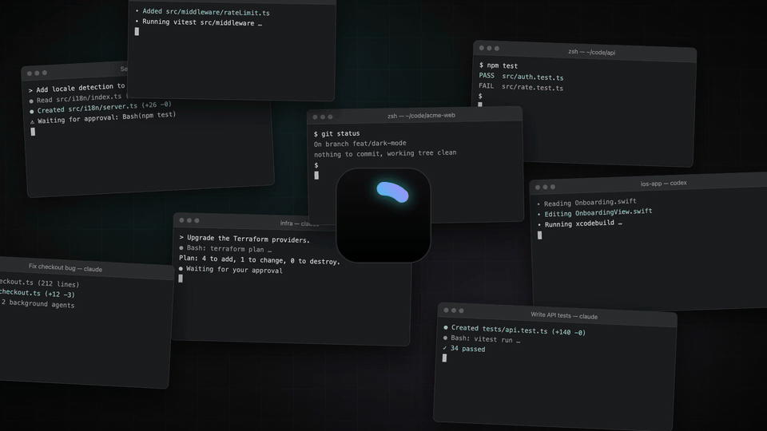

# omux

**The native agentic development platform for the Mac: a 5 MB terminal that runs fleets of Claude Code and Codex sessions.**

Written in Swift on SwiftTerm, no Electron, launches instantly. omux keeps many [Claude Code](https://claude.com/claude-code) and [Codex](https://developers.openai.com/codex/cli) sessions in one window, shows you which one needs you, lets you answer from the sidebar, and gives each session its own branch.




Eight seconds of the [37-second tour](https://omux.app/#tour), or the [23-second version](https://omux.app/).

[**Download the latest release**](https://github.com/onurozcan/omux/releases/latest) · signed and notarized · Apple Silicon, macOS 14+

---

## Why omux

Running one agent is easy. Running eight is a tab-switching job: you poll each terminal to see whether it's waiting on you, and you lose a conversation every time a window closes.

omux turns that into a dashboard.

- **One sidebar for every agent.** Projects hold sessions. Each session shows whether its agent is working, needs you, or is done. The Dock badge counts the ones waiting.
- **Answer without switching.** Claude Code permissions and Codex approvals have Allow and Deny buttons right on the session. A notification takes you to the session that needs you.
- **Nothing gets lost.** Every session keeps its exact conversation across restarts and relaunches.
- **Parallel work that stays apart.** A worktree session gets its own branch and folder. The pull request's checks and reviews appear next to it, and failing checks go to the agent in one click.
- **Review before you merge.** Read the diff, leave notes on lines, send them to the agent as one message.
- **Native and small.** SwiftUI and SwiftTerm, a 5 MB download, no telemetry.

---

## Features

| Feature | What it does |
| --- | --- |
| **Projects and sessions** | A project is a folder plus a default agent. Sessions live under it in the sidebar: drag to reorder, rename, color, move between projects. |
| **Conversations that resume** | Each Claude Code session keeps its session ID and each Codex session its thread, so Restart and relaunch reopen the exact conversation. |
| **Live status** | Working, needs you or done, per session. The Dock badge counts sessions waiting on you, and a notification brings you to the right one. |
| **Allow or deny from the sidebar** | Claude Code tool permissions and Codex approvals answered without switching sessions. Deny lets you tell the agent what to do instead. |
| **Panes** | Sessions of a project arranged in the window: split right or down, drag from the sidebar onto an edge, resize, move, maximize. One arrangement per project, saved. |
| **The `omux` command** | Programs in a session can list the project's sessions, read their screens, and start sessions of their own to send text to. Scoped to the project, children only, every action shown as a banner. [docs/cli.md](docs/cli.md) |
| **Subagents** | Every subagent of Claude Code or Codex listed with its current tool. Click one to read its transcript. |
| **Project defaults** | Each project can choose Terminal or Transcript for its sessions, and the model and effort new sessions start with. |
| **Worktree sessions** (⌥⌘T) | A session on its own branch and folder, so parallel agents never touch each other's files. A per-project setup command runs first, like `cp "$OMUX_REPO/.env" . && npm install`. |
| **Pull request status** | With the [GitHub CLI](https://cli.github.com): checks, reviews and merges next to the session. Failing checks' logs sent to the agent in one click. Merged pull requests offer to clean up the worktree. |
| **Changes** (⌥⌘2) | The session's diff against its base branch. Click a line to leave a note, then send all notes to the agent in one message. |
| **Files** (⌥⌘1) | The session's folder, with previews of code, Markdown, images, PDFs and anything Quick Look shows. Text files open in a small editor with syntax colors: make a change, ⌘S saves. ⌘-click a path in the terminal to open it. |
| **Transcript view** (beta) | Settings › Session View shows every session as chat instead of the terminal: your prompts, the agent's replies with highlighted code, tool calls with diffs and output, Allow and Deny cards, and a box that types into the terminal and starts the agent if needed. Read from Claude Code's transcript file or Codex's thread; the terminal keeps running underneath. |
| **Browser** (⌥⌘3) | A web view per session that opens the local server the session prints. Pick an element to send its HTML, styles and a screenshot to the prompt. |
| **Images and files in the prompt** | Paste an image or drop files onto the terminal, and the agent gets their paths as attachments. |
| **Recent conversations** (⇧⌘O) | Claude Code's and Codex's recent conversations, reopened as sessions. |
| **Usage limits** | The selected provider's plan limits at the bottom of the sidebar. |
| **Open folders from anywhere** | Finder's "Open in omux", a folder dropped on the Dock icon, or `open -a omux <folder>`. |
| **The rest** | Notifications with the macOS sound of your choice, themes, terminal fonts, a quick switcher (⌘K), signed automatic updates. |

Details for every row are in [docs/features.md](docs/features.md). Codex sessions have [their own page](docs/codex.md).

---

## Install

Download `omux-<version>.dmg` from the [latest release](https://github.com/onurozcan/omux/releases/latest), open it and drag omux to Applications. The app is signed with a Developer ID and notarized, so it opens without a warning.

Or build it yourself, which installs into `/Applications`:

```sh
./build.sh
open /Applications/omux.app
```

Beta builds, distribution builds and tests are in [docs/building.md](docs/building.md).

### Requirements

- A Mac with Apple Silicon running macOS 14 or later
- [Claude Code](https://claude.com/claude-code) installed as `claude` for Claude sessions. Plain shell sessions work without it.
- Codex CLI 0.165.0 or later installed as `codex` for Codex sessions
- To build from source: Swift 6.2 or later (Xcode 26 or the Command Line Tools)

---

## Keyboard shortcuts

| Action | Shortcut |
| --- | --- |
| New session / new shell / new project | ⌘T / ⇧⌘T / ⇧⌘N |
| New session in a worktree | ⌥⌘T |
| Open folder / recent conversation | ⌘O / ⇧⌘O |
| Close session | ⌘W |
| Rename / edit session | ⌘R / ⌘I |
| Restart session | ⇧⌘R |
| Interrupt (Ctrl-C) | ⇧⌘. |
| Start or continue the session | ⇧⌘↩ |
| Jump to session | ⌘K |
| Next / previous session | ⇧⌘] / ⇧⌘[ |
| Session 1–9 in the current project | ⌘1 … ⌘9 |
| Right panel / Files / Changes / Browser | ⌥⌘F / ⌥⌘1 / ⌥⌘2 / ⌥⌘3 |
| Terminal font bigger / smaller / default | ⌘+ or ⌘= / ⌘− / ⌘0 |

---

## Privacy

omux has no telemetry.

It talks to the network for three things:

- your plan's usage limits, with Claude Code's own login read from the Keychain
- pull request status, through `gh` and its own login
- a daily update check against omux.app

Nothing about you or your machine is sent. Every network path and local file is listed in [docs/privacy.md](docs/privacy.md).

---

## Contributing

Pull requests are welcome. The [changelog](CHANGELOG.md) lists what changed in each version, with its pull request.

omux is an independent project and is not affiliated with or endorsed by Anthropic or OpenAI. Claude and Claude Code are trademarks of Anthropic.

## License

[MIT](LICENSE)
