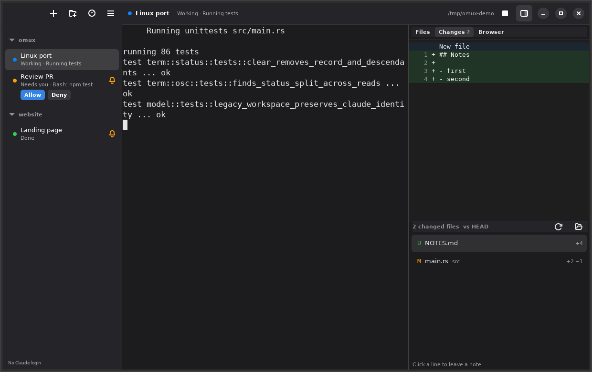

# omux for Linux

A native Linux version of omux, built with GTK 4, libadwaita, VTE (the
terminal widget behind GNOME Terminal) and WebKitGTK. It does what the macOS
app does: runs Claude Code and Codex sessions side by side, grouped into
projects. Each session resumes its own conversation, and the sidebar shows
whether its agent is working, needs you or is done.



This is a separate Rust app. It doesn't share code with the Swift app, but
it uses the same `workspace.json` format, the same settings keys and the
same behavior. [docs/PARITY.md](docs/PARITY.md) describes that behavior.
[docs/ROADMAP.md](docs/ROADMAP.md) lists the decisions that differ on Linux.

## Requirements

- GTK 4.14, libadwaita 1.5, VTE 0.76 (GTK 4 build) and WebKitGTK 6.0 or
  later. Ubuntu 24.04, Debian 13 and Fedora 40 have these.
- [Claude Code](https://claude.com/claude-code) installed as `claude`, for
  Claude sessions. Plain shell sessions work without it.
- Codex CLI 0.165.0 or later installed as `codex`, for managed Codex
  sessions.
- Optional:
  - `git`, for worktree sessions and the Changes panel.
  - [GitHub CLI](https://cli.github.com) `gh`, for pull request status.

## Install

On Ubuntu or Debian, install the libraries:

```sh
sudo apt install libgtk-4-1 libadwaita-1-0 libvte-2.91-gtk4-0 libwebkitgtk-6.0-4
```

Then install omux. Each CI run of the Linux workflow publishes the
`omux-linux-x86_64` artifact, which holds a `.deb` and a tarball. Choose
one:

```sh
sudo apt install ./omux.deb                 # system-wide
# or
tar xzf omux-linux-x86_64.tar.gz && omux-linux-x86_64/install.sh   # ~/.local, no root
```

omux then appears in the app grid. Ways to open a folder in it:

- Files › Open With › omux
- `omux <folder>` (the folder opens in the running instance)
- drop a folder on the sidebar

## Build

```sh
sudo apt install cargo libgtk-4-dev libadwaita-1-dev libvte-2.91-gtk4-dev libwebkitgtk-6.0-dev
cd linux
cargo build --release
./install.sh            # or run target/release/omux
```

Rust 1.85 or later is needed. `./install.sh --uninstall` removes a
`~/.local` install.

## What's different from macOS

| macOS | Linux |
| --- | --- |
| ⌘ shortcuts | GNOME Terminal-style Ctrl+Shift shortcuts, so readline keys stay with the shell. The full list is under Main menu › Keyboard Shortcuts. |
| Dock badge | A count on the Ubuntu Dock / Dash to Dock icon (`com.canonical.Unity.LauncherEntry`), and `(N)` in the window title. |
| Keychain login for usage limits | `~/.claude/.credentials.json`, which is where Claude Code keeps it on Linux. |
| Clean environment with a Homebrew PATH | Sessions inherit omux's environment, which carries the display, D-Bus, SSH agent and locale. Claude Code's nesting markers are removed. |
| Quick Look | Previews for Markdown, text, images, audio, video, PDF and SVG. Anything else opens in its default app. |
| FSEvents in the Changes panel | Polled every 2 s while the panel is open. A recursive inotify watch of a large repository can run out of watches. |
| `~/Library/Application Support/omux` | `$XDG_CONFIG_HOME/omux` (`~/.config/omux`). `OMUX_WORKSPACE_DIRECTORY` overrides it, as on the Mac. |

### Agent status

The Mac reads Claude Code's status from SwiftTerm, which decodes OSC 7501
"program status" reports. VTE has no hook for unknown escape sequences, so
on Linux omux owns the session's pseudo-terminal:

1. A reader thread watches the output for OSC 7501, OSC 9, OSC 777 and
   OSC 133.
2. Every byte is passed on to VTE unchanged.
3. Input reaches the program through VTE's `commit` signal.

The OSC 7501 parser and record store are a port of SwiftTerm 1.99.1. The
scanner also answers the `OSC 7501 ; ?` support query.

## Privacy

The network paths are the same as on the Mac:

- **Usage limits:** the Claude Code token goes to
  `https://api.anthropic.com/api/oauth/usage`. It is never written or
  logged.
- **Pull requests:** `gh pr view` runs about once a minute.
- **Codex:** loopback WebSockets with a random bearer token that stays in
  memory.

Local files:

- `~/.config/omux/workspace.json` (plus `.bak`) and `settings.json`
- `~/.claude/projects`, read to list conversations and subagents
- the system temp folder, for pasted images (`omux-paste`) and browser
  picks (`omux-picks`)

## Development

```sh
cargo fmt --check && cargo clippy --all-targets -- -D warnings && cargo test
OMUX_CODEX_INTEGRATION=1 cargo test -- --ignored   # needs the codex CLI; no model calls
```

CI (`.github/workflows/linux.yml`) runs on Ubuntu 24.04 when `linux/`
changes. Besides fmt, clippy and the tests, it runs these steps:

- the Codex integration test against the real CLI
- the release build and `.deb`
- desktop entry and AppStream validation
- screenshots of the app under Xvfb, driven through its D-Bus actions

Code map:

| Path | What |
| --- | --- |
| `src/model.rs`, `persistence.rs`, `settings.rs`, `swift_json.rs` | Workspace schema, Swift-compatible JSON, settings |
| `src/term/` | PTY, OSC scanner, program status records |
| `src/app.rs` | Sessions and their lifecycle, attention, saving (the `Store` counterpart) |
| `src/claude.rs`, `codex.rs`, `codex_client/` | Claude Code files and subagents; managed Codex sessions |
| `src/git.rs`, `pulls.rs` | Git, worktrees, `gh pr view` |
| `src/ui/` | Window, sidebar, header, dialogs, panels |
